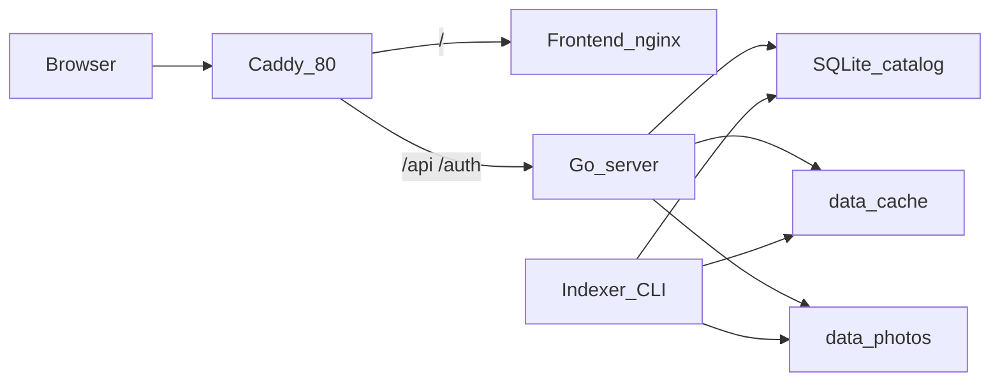

# Memries — Context Map

Stay in this repository. Do not read or edit parent directories.

## Decisions

| ADR | Decision |
|-----|----------|
| [0001](docs/adr/0001-agent-guidance-and-context-map.md) | AGENTS.md is the operating contract; CONTEXT-MAP.md is the persistent map; stay in this repo |
| [0002](docs/adr/0002-spa-owned-timeline-groups.md) | Memories buckets Photos in the SPA; `/api/timeline` is not the feed, but [0017](docs/adr/0017-date-scrubber.md) reads it as the scrubber's histogram |
| [0003](docs/adr/0003-modular-monolith-compose.md) | Compose modular monolith (Go API, catalog, Caddy, React); not platform CDK. Its Arango and Dex parts are superseded by [0014](docs/adr/0014-pluggable-sql-store.md) / [0016](docs/adr/0016-local-password-auth.md) |
| [0004](docs/adr/0004-owner-scoped-index-job-and-cursor-photos.md) | Browser-started owner-scoped Index run; composite-cursor `/api/photos` |
| [0005](docs/adr/0005-capture-time-stable-identity.md) | Capture clock, stable Photo `_key`, persisted owner library |
| [0006](docs/adr/0006-truncate-arango-for-resync.md) | Superseded by [0014](docs/adr/0014-pluggable-sql-store.md) |
| [0007](docs/adr/0007-viewport-forced-compact-thumbs.md) | Compact grids: 256 at viewport ≥1280px, else 512; no `srcset` |
| [0008](docs/adr/0008-smart-date-search.md) | Search smart dates are SPA-parsed; `/api/photos` gets `month` / `local_from` / `local_to`; Filter opens Search |
| [0009](docs/adr/0009-e2e-docker-skill-owns-isolated-stacks.md) | Superseded by [0012](docs/adr/0012-e2e-one-suite-two-profiles.md) |
| [0010](docs/adr/0010-memries-platform-quality-shelf.md) | Local `/platform-quality`: a11y → e2e suite → lint → format; e2e slices superseded by [0012](docs/adr/0012-e2e-one-suite-two-profiles.md) |
| [0011](docs/adr/0011-turborepo-pnpm-workspace.md) | pnpm + Turbo workspace under `apps/`; prune + fill-extras in Docker; quality shelf paths retargeted |
| [0012](docs/adr/0012-e2e-one-suite-two-profiles.md) | One `memries-e2e` stack; `/e2e-docker` plans and records id `memries`; local headed + 4 workers, CI one-by-one; one owner account per worker |
| [0013](docs/adr/0013-admin-managed-sources.md) | Admin-managed Sources (local / SMB / WebDAV) replace the email folder; keys `<source id>/<path>`; thumbs stay on local disk |
| [0014](docs/adr/0014-pluggable-sql-store.md) | Relational catalog over `database/sql`: SQLite default, PostgreSQL optional; ArangoDB dropped |
| [0015](docs/adr/0015-build-tagged-thumbnail-backend.md) | Thumbnail backend chosen by build tag: pure Go default, `-tags vips` (3.3x) for the device; chained ladder; atomic writes |
| [0016](docs/adr/0016-local-password-auth.md) | Local password sign-in (argon2id, `POST /auth/login`), rate limited by address and by account; Dex and OIDC dropped |
| [0017](docs/adr/0017-date-scrubber.md) | Right-edge date scrubber over the full month histogram from `/api/timeline`; jumps page backwards; photo page size 50 → 500 |
| [0018](docs/adr/0018-multi-select-and-batch-actions.md) | Hover multi-select + selection toolbar; batch favorite and batch album-add, all-or-nothing |
| [0019](docs/adr/0019-pointer-driven-timeline-zoom.md) | Granularity is a 3-step zoom ladder (year/month/week, no day); Ctrl+wheel and pinch, − level + control replaces the radiogroup, period headings drill in, level kept in `sessionStorage` |

## Contexts

| Context | Path | Start here |
|---------|------|------------|
| Photo library / API | [apps/backend/](apps/backend/), [CONTEXT.md](CONTEXT.md) | [cmd/server/main.go](apps/backend/cmd/server/main.go), [internal/api/api.go](apps/backend/internal/api/api.go), [internal/db/store.go](apps/backend/internal/db/store.go), [internal/db/models.go](apps/backend/internal/db/models.go) |
| Indexer | [apps/backend/cmd/indexer](apps/backend/cmd/indexer/main.go), [internal/index](apps/backend/internal/index/indexer.go) | HTTP job or CLI walks each of the Owner's Sources → identity → EXIF → thumbs → upsert ([0013](docs/adr/0013-admin-managed-sources.md)) ([0004](docs/adr/0004-owner-scoped-index-job-and-cursor-photos.md)) |
| Timeline UI | [apps/frontend/src](apps/frontend/src) | [App.tsx](apps/frontend/src/App.tsx) → [Timeline.tsx](apps/frontend/src/components/Timeline.tsx) → [groupPhotos.ts](apps/frontend/src/lib/groupPhotos.ts); catalog in [lib/api.ts](apps/frontend/src/lib/api.ts) |
| Local ops | [docker-compose.yml](docker-compose.yml), [deploy/](deploy/), [Makefile](Makefile) | Caddy routes `/api` and `/auth`; catalog reset `make db-clear` ([0014](docs/adr/0014-pluggable-sql-store.md)); images [Dockerfile.frontend](Dockerfile.frontend) / [Dockerfile.backend](Dockerfile.backend) |
| Isolated Playwright BDD | [apps/e2e/](apps/e2e/) | One suite on `memries-e2e` / 18080 ([0012](docs/adr/0012-e2e-one-suite-two-profiles.md)); skill [`.cursor/skills/e2e-docker/`](.cursor/skills/e2e-docker/) |
| Quality shelf | [`.cursor/skills/`](.cursor/skills/) | `/platform-quality` waves and last-runs ([0010](docs/adr/0010-memries-platform-quality-shelf.md), [0012](docs/adr/0012-e2e-one-suite-two-profiles.md)); planner [`apps/scripts/app-fanout/app-fanout.mjs`](apps/scripts/app-fanout/app-fanout.mjs) |
| Build graph | [package.json](package.json), [turbo.json](turbo.json) | pnpm workspace + Turbo ([0011](docs/adr/0011-turborepo-pnpm-workspace.md)); host install [apps/scripts/install-requirements/](apps/scripts/install-requirements/) |



## Glossary

- **Photo** — a `photos` row; `key` is stable identity (path-first on Sync); `hash` is sha256 of current bytes; `kind` is `photo` today (video reserved). See [docs/adr/0005-capture-time-stable-identity.md](docs/adr/0005-capture-time-stable-identity.md).
- **Owner** — `users` row keyed by sha1(lowercase email); photos filter `owner_id`.
- **TakenAt** — EXIF `DateTimeOriginal` (then digitized / `DateTime`), else filesystem birth, else mtime; UI buckets on `taken_at_local` ([0005](docs/adr/0005-capture-time-stable-identity.md)).
- **Granularity** — `year` / `month` / `week` / `day`; buckets come from `taken_at_local`, week as ISO year-week ([0014](docs/adr/0014-pluggable-sql-store.md)). Memories buckets in the SPA, not `/api/timeline` ([docs/adr/0002-spa-owned-timeline-groups.md](docs/adr/0002-spa-owned-timeline-groups.md)).
- **Storage** — interface; `local`, read-only `smb` and `webdav` implemented; `sources.Registry` routes `<source id>/<path>` keys to them; `s3` factory returns “phase 3”.
- **Source** — admin-managed folder (`sources` table) feeding one Owner's library; password sealed with a key derived from `MEMRIES_SESSION_KEY` ([0013](docs/adr/0013-admin-managed-sources.md)).
- **Thumb** — JPEG cache under `MEMRIES_CACHE_ROOT`, paths `<key[:2]>/<key>/{s,m,l}.jpg` for 256 / 512 / 1024. Compact grids use 256 when the viewport is ≥1280px, else 512 ([docs/adr/0007-viewport-forced-compact-thumbs.md](docs/adr/0007-viewport-forced-compact-thumbs.md)).
- **Album** — named owner-scoped set of Photos (`albums` + `album_photos`). Domain language: [CONTEXT.md](CONTEXT.md).
- **Index run** — persisted owner-scoped job; walks every Source of the Owner (a legacy `data/photos/<email>` folder becomes a Source on first run) ([docs/adr/0004-owner-scoped-index-job-and-cursor-photos.md](docs/adr/0004-owner-scoped-index-job-and-cursor-photos.md)).
- **Session** — cookie `memries`, 30 days, HttpOnly, Lax.

Owner ACL today: session user key vs `photo.owner_id` / `album.owner_id`. Sharing has no tables yet; [0014](docs/adr/0014-pluggable-sql-store.md) dropped the schema-only share edges until there is a query for them.

## HTTP (Caddy `:80`)

- `/` → frontend
- `POST /auth/login`, `POST /auth/logout` → backend. Outside `/api` on purpose: the session middleware guards `/api`, and you cannot present a session to get one ([0016](docs/adr/0016-local-password-auth.md))
- `/api/*` → backend + auth middleware: `GET /me`, `/timeline`, `/photos` (`year`, `month`, `local_from`, `local_to`, `favorite`, `q`), `/photos/{id}`, `/photos/{id}/favorite`, `PUT /photos/favorite` (batch), `/albums`, `/albums/{id}`, `/albums/{id}/photos`, `/thumb/{id}`, `/original/{id}`, `/index`, `/index/status`; admin only (`MEMRIES_ADMIN_EMAILS`): `/admin/sources` (GET, POST), `/admin/sources/{id}` (PUT, DELETE), `/admin/sources/{id}/scan`
- `/healthz` on the backend only (not via Caddy today)

## Module map (`apps/backend/internal/`)

- `config` — `MEMRIES_*` env
- `auth` — password sign-in (argon2id), cookie session, login rate limiting, `/api/me`
- `db` — connect, schema, users, photos/timeline AQL
- `storage` — `Storage` + `local.go`, `smb.go`, `webdav.go`
- `sources` — Source catalog, validation, sealed passwords, composite read-only Storage, legacy folder migration
- `exif` / `thumb` / `index` — indexer pipeline. `thumb`'s renderer is build-tagged ([0015](docs/adr/0015-build-tagged-thumbnail-backend.md)); only `cmd/indexer` ever needs the cgo build
- `api` — JSON + byte streaming

## Frontend

- Cookie `credentials: "include"`; a 401 throws `UnauthorizedError`, and a 401 from `/api/me` is what makes `App` render `LoginScreen`
- Splash polls `/api/index/status` and may `POST /api/index` ([0004](docs/adr/0004-owner-scoped-index-job-and-cursor-photos.md))
- Memories pages `/api/photos` and groups in the SPA; `/api/timeline` is unused by the UI ([docs/adr/0002-spa-owned-timeline-groups.md](docs/adr/0002-spa-owned-timeline-groups.md))
- Granularity is React state (not `localStorage`); theme is the only persisted UI key

## Photo layout

An **Index run** walks the Owner's Sources; the client never sends a path. Photo `storage.path` is `<source id>/<path inside the Source>` (`storage.backend` = `source`). CLI: `indexer -owner <email> [-source <id>]`.

Accepted media extensions: `.jpg`, `.jpeg`, `.png`, `.webp`, `.gif`.

## Catalog tables

`photos`, `users`, `albums`, `album_photos` (Album membership), `index_runs`, `sources`, `schema_migrations`.

Timestamps are unix microseconds in `BIGINT`; `taken_at_local` stays TEXT because the date filters substring it.

Indexes: `(owner_id, taken_at DESC, key DESC)` (the cursor's index scan), unique `(owner_id, hash)` (owner-scoped dedup), `(owner_id, storage_path)`, `(owner_id, taken_at_local)`, unique `email`.

Migrations are embedded `.sql` under [internal/db/migrations](apps/backend/internal/db/migrations/), applied in order and tracked in `schema_migrations`.

## Known constraints (do not “fix” unless asked)

- The SQLite catalog is one file (`MEMRIES_DB_DSN`, bind-mounted at `/data/db`). `make db-clear` deletes it and its `-wal` / `-shm` siblings; photos and thumbs are untouched.
- SQLite runs with `MaxOpenConns(1)` on purpose: catalog work is microseconds next to JPEG decoding, so serializing it removes every `SQLITE_BUSY` race. Index runs must keep write batches bounded.
- A Photo key is normally the content hash (ADR 0005). When another Owner already holds that key, the indexer derives a distinct one, so identical bytes in two libraries stay two Photos.
- Dev login: `admin@example.com` with `BOOTSTRAP_PASSWORD` from `.env`. Bootstrap only fills an *empty* password, so a changed password is not reset on restart ([0016](docs/adr/0016-local-password-auth.md)).
- Sign-in failures are uniform on purpose: wrong password, unknown address and "no password set" all return the same 401 body and spend the same time. Do not add a reason to that response.
- `thumb.Generate` takes the original's `[]byte`, not an `io.Reader`: the indexer already holds them for the sha256, and a reader meant holding every frame twice.
- Thumbs after the largest are resampled from the rung above, not from the full frame. Every step is a halving, so this is a speed win, not a quality tradeoff.
- Indexer concurrency defaults to 4 (the board has four cores): measured 3.7x throughput at ~230 MiB peak RSS. `GOMEMLIMIT=512MiB` bounds the heap instead of cutting workers — but it does not bound `-tags vips`, whose pixels live in C (libvips' own cache is disabled at init instead).
- The thumbnailer has two backends and `internal/thumb`'s tests must pass under both. Run the suite twice; `thumb.Backend` is logged at indexer start so the live build is identifiable:

  ```sh
  go test ./internal/thumb/                      # pure Go, the default
  go build -tags vips ./cmd/indexer              # needs libvips + pkg-config
  ```

  On Homebrew, libarchive is keg-only, so prefix either vips command with `PKG_CONFIG_PATH="$(brew --prefix libarchive)/lib/pkgconfig"`.
- The date scrubber's track comes from `/api/timeline` (month granularity, whole library), never from the loaded photos: a track built from what is loaded would rescale while scrolling. It maps dates to positions only — `justifyRows` packs by real aspect ratios, so bucket heights are not derivable from counts. All of it lives in `lib/scrubberScale.ts` ([0017](docs/adr/0017-date-scrubber.md)).
- Granularity is the zoom level: it sets the grouping *and* `targetRowHeight`, so never change one without the other. The ladder, stepping and wheel arithmetic live in `lib/zoom.ts`; a wheel event yields at most one level and resets its accumulator, because a mouse notch is 100-120px while a trackpad pinch is a stream of single digits ([0019](docs/adr/0019-pointer-driven-timeline-zoom.md)). The listener must stay non-passive and on the timeline root: React's `onWheel` is passive and cannot `preventDefault`, and the list container is keyed by granularity.
- Row height drops ~0.7 per zoom level (`targetRowHeight`), so a notch resizes as well as regroups; year and month sharing a height made the control look broken. The level is remembered per tab in `sessionStorage` through `useStoredZoom`, validated against the ladder on read because an old tab may hold `day`.
- A period heading drills one level in, anchored on the group clicked rather than the viewport's top group. The action is on `aria-describedby`, never the button's label: the heading is its section's `aria-labelledby` target, which `revealPhoto` and the heading steps both match exactly ([0019](docs/adr/0019-pointer-driven-timeline-zoom.md)).
- The pinned period names the group at the top of the viewport, except at the very end of the list, where it names the last group on screen (`currentGroupIndex` in `Timeline.tsx`). The final group can never reach the top — nothing below it to scroll against — so without that branch, reaching the oldest photos told the reader they were looking at a later month.
- `fetchPhotosPage` asks for 500 photos, the server cap. That is what keeps a scrubber jump to an unloaded month at ~24 requests instead of ~240. Do not lower it without rereading [0017](docs/adr/0017-date-scrubber.md).
- A batch action is all or nothing. `SetFavorites` and `AddPhotosToAlbum` check ownership of every id before writing and answer 403 on any foreign id, rather than applying the valid part ([0018](docs/adr/0018-multi-select-and-batch-actions.md)). The `internal/api` fakes mirror that rule on purpose — a more permissive fake would hide the bug the check exists for.
- Multi-select reaches tiles through `usePhotoSelection`, not props. A grid with no provider is inert, which is why Favorites, Search and Album pages still behave as before. `PhotoCard`'s checkbox is a sibling of the tile button, since buttons cannot nest.
- Thumb URLs carry `&v=<photo hash>`, always built through `lib/photoSrc.ts`. The handler ignores `v`; it exists because thumbs are served `private, max-age=31536000, immutable` and a resynced Photo keeps its id and overwrites the same disk path, so only a changed URL can bust that cache. Never hand-build `/api/thumb/...`, and keep `Cache-Control` as it is. Album covers are the one exception: the album JSON carries `cover_photo_id` with no hash, so covers go unversioned and may show a stale image until reload.
- The default catalog window is unbounded below (ADR 0005). Do not reintroduce a 1970 floor: scanned film carries pre-epoch EXIF, and those instants are negative microseconds, which `BIGINT` stores and sorts correctly. The 2100 ceiling stays.
- Sharing has no tables. Add one when a query needs it, not before.
